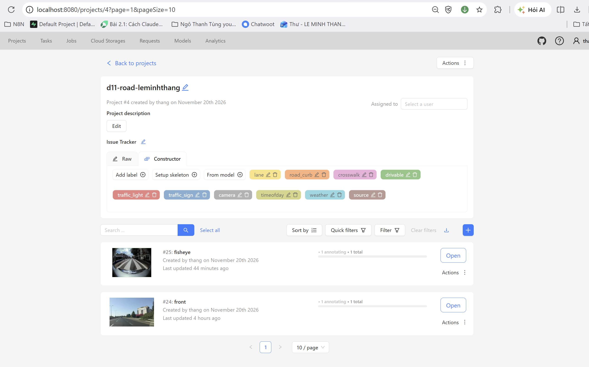
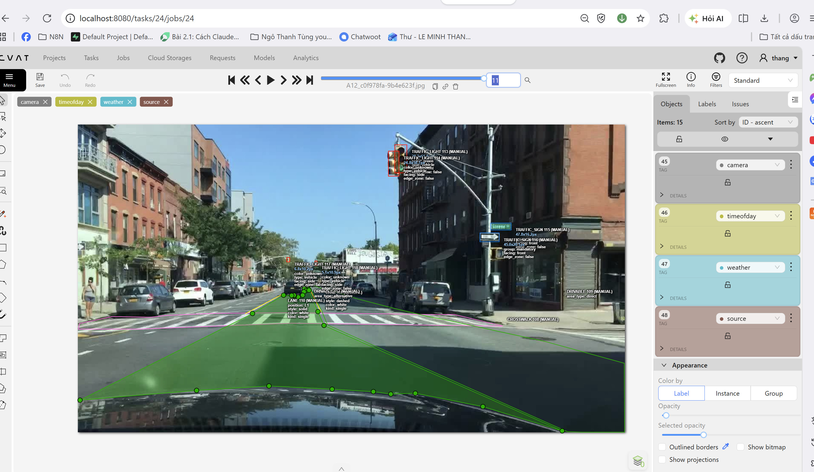
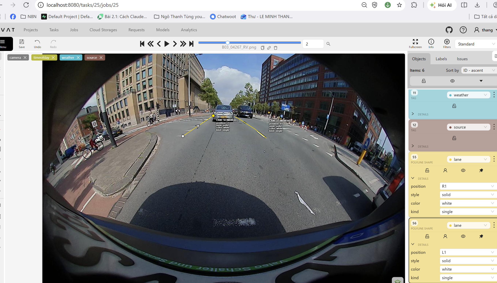
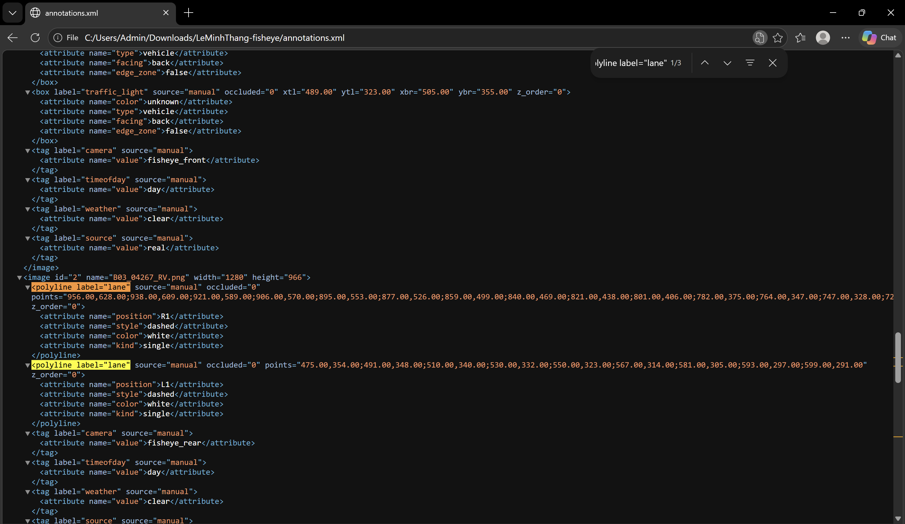

# Báo cáo cá nhân — Ngày 11

Họ tên: **Lê Minh Thắng** — Mã học viên: **2A202603292**.

Phiên bản CVAT: v2.81.0 (Docker, localhost:8080).

Guideline: **Road v1.0** — Lần nộp (`revision` trong manifest): **1**.

Thời điểm export: front **20/11/2026 22:27:30**, fisheye **20/11/2026 22:21:43** (UTC+7, quy đổi từ trường `meta/dumped` trong XML; cần đối chiếu giờ hiển thị trên CVAT). Manifest được tạo lúc **22:42:27 cùng ngày**. Số lần nộp lại sau Rework: 0, chưa có lịch sử nộp lại; manifest hiện tại ghi revision 1.

## 1. Kiểm project

| Mục | Đúng như guideline Road v1.0? | Ghi chú |
| --- | --- | --- |
| 6 label, đúng kiểu | Đúng theo metadata hai ZIP | `lane`, `road_curb`: polyline; `crosswalk`, `drivable`: polygon; `traffic_light`, `traffic_sign`: rectangle. |
| Thuộc tính và giá trị | Khớp khai báo Road v1.0 | Đã đối chiếu tên, kiểu nhập và danh sách giá trị với taxonomy; độ đúng theo cảnh cần QC bằng mắt/GT. |
| 4 tag ảnh | Đủ 20/20 ảnh | Mỗi ảnh có `camera`, `timeofday`, `weather`, `source`, mỗi tag có thuộc tính `value`. Tag camera khớp tên ảnh; tất cả `source=real`. |

Cách kết thúc polyline trên bản CVAT này: nhấn **N** sau điểm cuối, theo hướng dẫn CVAT của repo; cần xác nhận nếu đã đổi phím tắt.

Cách đặt tag ảnh trên bản CVAT này: dùng **Tag**, đặt `camera` trước, rồi ba tag còn lại; mở **Details** chọn `value`. Với các nhãn nhập từ XML, đã kiểm lại giá trị trên CVAT trong phiên gán fisheye.

## 2. Số lượng đã gán

| Task | Ảnh | lane | road_curb | crosswalk | drivable | traffic_light | traffic_sign |
| --- | ---: | ---: | ---: | ---: | ---: | ---: | ---: |
| front | 12 | 18 | 4 | 2 | 7 | 21 | 18 |
| front-extra (đã làm 0 / 4) | 0 | 0 | 0 | 0 | 0 | 0 | 0 |
| fisheye | 8 | 3 | 2 | 8 | 3 | 6 | 0 |
| fisheye-extra (đã làm 0 / 4) | 0 | 0 | 0 | 0 | 0 | 0 | 0 |
| **Tổng** | **20** | **21** | **6** | **10** | **10** | **27** | **18** |

Đếm trực tiếp trong hai XML: **92 shape** (front 70, fisheye 22) và **80 tag** (48 + 32), tổng **172 nhãn**. Đủ A01–A12, B01–B08; số ảnh và từng loại shape khớp manifest, không có ảnh extra.

## 3. Bảng ca khó

| Ảnh | Nhãn | Phân vân giữa | Đã chọn | Lý do |
| --- | --- | --- | --- | --- |
| A05, A06 | lane | Thiếu nhãn hay không thấy vạch | A05 không có lane; A06 chỉ có L1 | `lint` báo thiếu L1/R1. Cần coach nhìn ảnh và xác nhận ngoại lệ; không tự vẽ vạch suy đoán. |
| A07–A10 | lane / phạm vi ảnh | Thiếu lane hay chỉ yêu cầu đèn/biển | A07–A08 chỉ gán đèn, A09–A10 chỉ gán biển | Cần đối chiếu bảng kế hoạch ảnh và coach; chưa có căn cứ tự miễn các cảnh báo QC1-02. |
| A03 | lane L1 | Trắng đơn hay vàng đôi | XML hiện tại: `white / single` | Cần rà lại màu và kiểu theo ảnh gốc; đây là giá trị đang có, chưa xác nhận đúng. |
| B02 | traffic_light | Không thấy màu hay đèn tắt | 4 box `facing=back`, `color=unknown`; 4 box sát viền có `edge_zone=true` | Không suy ra `off` khi chỉ thấy lưng đèn; bật edge_zone theo vị trí tâm box. |
| B06 | lane | L1/R1 hay other | `position=other`, trắng đứt đơn | Camera `fisheye_left` phải dùng other theo guideline. |

## 4. Phiếu QC 1 nhận được

Bạn kiểm lô của tôi: Nguyễn Tiến Đạt — MSHV 2A202603289.
Quyết định nhận được: Rework.

Phạm vi kiểm tra: 6 ảnh A01–A06, tổng cộng 45 nhãn.

| Mã lỗi | Số lỗi | Đồng ý? | Đã sửa? |
| --- | ---: | --- | --- |
| QC1-04 | 1 | Có | Chưa xác nhận |
| QC1-06 | 1 | Có | Chưa xác nhận |
| QC1-07 | 2 | Có | Đã điều chỉnh direct/alternative ở A04 |
| QC1-07 | 1 | Có | Cần kiểm tra crosswalk A06 |

Kết quả QC: 2 lỗi nặng (tạm xếp mức), 3 lỗi chính,
0 lỗi nhẹ. Tỷ lệ lỗi chính: 3/45 = 6,67%.

Cần tiếp tục rà soát các lỗi còn lại và kiểm tra lại
sau khi chỉnh sửa.

## 5. Kiểm file export

Link tải file nhãn: [Google Drive — LeMinhThang-front.zip và LeMinhThang-fisheye.zip](https://drive.google.com/drive/folders/1oL08cHVIucmd5HfiWxHdD27y43eXzt9z?usp=sharing). Thư mục này chứa hai ZIP nhãn; manifest và phiếu QC1 được bàn giao cùng báo cáo trong repo.

| File | Mở lại được? | Số shape ảnh 1 (job / file) | Số shape ảnh 2 (job / file) | Tag camera có trong XML? |
| --- | --- | --- | --- | --- |
| `LeMinhThang-front.zip` | Có, đọc được annotations.xml | Cần đối chiếu job / **4 (A01)** | Cần đối chiếu job / **3 (A02)** | Có, 12/12 ảnh |
| `LeMinhThang-fisheye.zip` | Có, đọc được annotations.xml | **1 / 1 (B01)** | **6 / 6 (B02)** | Có, 8/8 ảnh |

Số phía job fisheye lấy từ phiên kiểm job 25 trước đó; cần xác nhận lại nếu sau đó có sửa nhãn. Hai ZIP chỉ chứa `annotations.xml`, không kèm ảnh; dung lượng **36.722 byte / 23.575 byte** và SHA-256 đều khớp manifest. Trong XML, 172 shape/tag đều có `source="manual"`.

Lệnh đã chạy tại thư mục gốc repo bằng PowerShell:

```powershell
$env:PYTHONPATH = 'src'
python -X utf8 -B -m road_lab.road_check lint LeMinhThang-front.zip LeMinhThang-fisheye.zip
```

**Kết quả thực tế: 20 ảnh, 15 cảnh báo**, khớp số lượng trong manifest:

| Mã | Mức | Số cảnh báo | Ảnh / nội dung |
| --- | --- | ---: | --- |
| QC1-02 | nặng | 11 | A05 thiếu L1, R1; A06 thiếu R1; A07, A08, A09, A10 mỗi ảnh thiếu L1 và R1. |
| QC1-04 | chính | 2 | A02 lane#2 và A12 lane#3: điểm đầu cao hơn điểm cuối, cần kiểm chiều gần → xa. |
| QC1-12 | nhẹ | 2 | A03 lane#0 và A05 drivable#0: mỗi nhãn có một điểm lặp liền nhau. |

Toàn bộ cảnh báo thuộc front; fisheye **0 cảnh báo**. `lint` chỉ kiểm định dạng và đưa gợi ý, không chấm chất lượng theo GT. **Chưa xác nhận đủ điều kiện nộp**: cần xử lý cảnh báo, coach xác nhận các ngoại lệ QC1-02, rồi chạy lại lint. Báo cáo này không sửa ZIP hoặc manifest.

Trạng thái job: fisheye job 25 có ảnh xác nhận completed trong phiên trước; **cần bổ sung xác nhận completed của front job 24** và kiểm tra trạng thái hiện tại trước khi nộp.

## 6. Ảnh chụp màn hình









4. **Đoạn XML thực tế:** trích lane L1 của B03 từ `LeMinhThang-fisheye.zip`; cần bổ sung ảnh chụp trình soạn thảo nếu coach yêu cầu ảnh cho mục này.

```xml
<polyline label="lane" source="manual" occluded="0" points="475.00,354.00;491.00,348.00;510.00,340.00;530.00,332.00;550.00,323.00;567.00,314.00;581.00,305.00;593.00,297.00;599.00,291.00" z_order="0">
  <attribute name="position">L1</attribute>
  <attribute name="style">dashed</attribute>
  <attribute name="color">white</attribute>
  <attribute name="kind">single</attribute>
</polyline>
```

## 7. Tự đánh giá

**Lỗi/cảnh báo gặp nhiều nhất và cách tránh ở Ngày 20:** QC1-02 xuất hiện 11 lần, nhưng cần coach phân biệt thiếu vạch thật với ngoại lệ. Tôi cần kiểm phạm vi label từng ảnh, rà L1/R1 khi nhìn thấy vạch và ghi rõ ca không thấy vạch. Với QC1-04, kiểm điểm đầu sát xe trước khi lưu; với QC1-12, tránh click lặp và xóa điểm thừa.

**Liên hệ với model và một trường hợp đã điều chỉnh:** đối chiếu ảnh chụp A04 trước đó với XML hiện tại cho thấy hai vùng đã đổi lại: `direct` ở làn giữa vàng đôi L1 và trắng đứt R1, `alternative` ở làn bên phải R1. Nếu đảo hai giá trị, nhãn huấn luyện phân đoạn vùng lái sẽ dạy model nhận làn bên cạnh thành làn đang đi. Tôi cần tự kiểm hình học và nhận QC lại; chưa có kết quả đối chiếu GT để khẳng định toàn bộ nhãn đạt yêu cầu.

## 8. (Tùy chọn, buffer) Từ polyline đến đích row-anchor

Không thực hiện phần tùy chọn; không ghi số liệu row-anchor.
